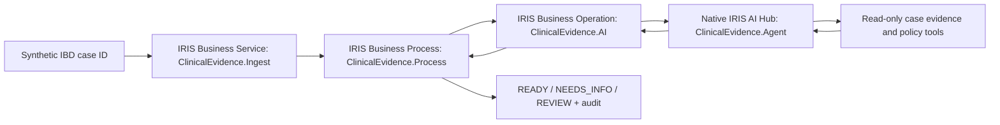

# Clinical Evidence Reconciler

**Turning expert-informed medical evidence checks into an auditable InterSystems IRIS AI Hub interoperability workflow.**

InterSystems AI Agents in Interoperability Workflows contest — November 2026.

## Problem and scope

Specialists reviewing suspected inflammatory bowel disease (IBD) referrals must consider symptoms, laboratory tests, infection testing, endoscopy, pathology, and other evidence that may arrive through different systems. An incomplete or conflicting packet can delay review or lead to unsupported conclusions.

This open-source **synthetic demonstration** uses InterSystems IRIS for Health AI Hub to evaluate whether a case packet is ready for a clinician, requires missing evidence, or needs manual reconciliation. **It does not diagnose IBD, offer treatment advice, or make autonomous triage decisions.** All cases and the example policy are fictional. No confidential clinical source documents or patient records are included.

## Architecture



The workflow uses `%AI.Agent`, `%AI.ToolSet` and `%AI.Tool` **inside an actual IRIS interoperability production**. The agent can call `GetCaseEvidence` and `GetReviewPolicy`; the business operation parses a structured response and the business process records the disposition. If the agent fails, the process falls back to `REVIEW` for manual attention.

**Important limitations:** The demo fixtures are FHIR-*inspired* JSON referencing resource IDs, not a deployed FHIR R4 repository or a standards-conformant FHIR Bundle. The policy is a fictional, manually structured `1.0` demo rule, not automatically generated or clinically approved. The agent response is not a validated clinical conclusion. This is an interoperability proof of concept, not a medical device.

## Environment

- InterSystems IRIS for Health **2027.1.0AI.109.0** Early Access community Docker image (must be downloaded separately from InterSystems; **not redistributable** through this repository)
- Docker Desktop or Docker Engine
- OpenAI API account with API credits, key stored **only in a local development environment**, not in code or GitHub
- Local-only port binding and synthetic data only

### Run with an existing `iris-aihub` Docker container

1. Download the proprietary IRIS AI Hub image from the InterSystems Early Access portal and load it into Docker following the official instructions.
2. Start IRIS with the `OPENAI_API_KEY` environment variable made available to **background interoperability processes**. Never post the key or commit an `.env` file. For local experimentation, keep management ports bound to `127.0.0.1`. The screenshot-verified instance used port `52774` on the host, mapped to `52773` in the container.
3. In PowerShell, from this repository folder:

```powershell
docker cp ".\src\ClinicalEvidence" iris-aihub:/tmp/ClinicalEvidence

@(
  'Set sc=$SYSTEM.OBJ.LoadDir("/tmp/ClinicalEvidence","ck",.errs)'
  'Write "COMPILE: ",$SYSTEM.Status.GetErrorText(sc),!'
  'ZWRITE errs'
  'Do ##class(ClinicalEvidence.Data).Seed()'
  'Do ##class(ClinicalEvidence.Demo).Run("IBD-001")'
  'Do ##class(ClinicalEvidence.Demo).Run("IBD-002")'
  'Do ##class(ClinicalEvidence.Demo).Run("IBD-003")'
  'HALT'
) | docker exec -i iris-aihub iris session IRIS
```

The production is defined in `src/ClinicalEvidence/Production.cls`; `Demo.Run` starts it if necessary, or reuses the already-running `ClinicalEvidence.Production` for subsequent cases, then routes a synthetic message through `ClinicalEvidence.Ingest` → `ClinicalEvidence.Process` → `ClinicalEvidence.AI`.

For a direct AI Hub provider check from the same container, see `ClinicalEvidence.Agent`. The agent's model/provider may need to be changed for a different account or build. Avoid putting keys in shell history, screenshots, or source files.

## Synthetic cases and expected dispositions

| Case ID | Scenario | Expected workflow disposition |
|---|---|---|
| `IBD-001` | Infection/microbiology and pathology evidence not documented | `NEEDS_INFO` |
| `IBD-002` | Relevant evidence packet present for specialist review | `READY` — **ready for human review**, not a diagnosis |
| `IBD-003` | Incompatible signed findings for the same endoscopy procedure | `REVIEW` |

These expectations are acceptance tests **for the fictional workflow only**. Do not treat them as clinical diagnostic criteria or performance estimates.

## Verification log

On **November 8, 2026**, the author tested this project locally on IRIS for Health AI Hub build 109:

- All 11 ObjectScript classes compiled successfully (`errs=0`).
- A direct native IRIS AI Hub model connectivity check returned `READY`.
- An IRIS interoperability production processed three synthetic IBD cases using the native agent (`AI USED: 1`).
- `IBD-001` yielded `NEEDS_INFO` with a stored raw agent response (`AGENT RESPONSE STORED: 1`).
- `IBD-002` yielded `READY` with `AI USED: 1`.
- `IBD-003` yielded `REVIEW` with `AI USED: 1`.
- The demo initially emitted `ErrProductionAlreadyRunning` on repeat invocations. `Demo.Run` was patched to reuse the active production. The corrected run still logs `ProductionAlreadyRunning` before reusing the production and completing successfully; this is a development limitation to clean up.

These are smoke-test results with fictional inputs, **not clinical validation or a quantitative assessment of diagnostic quality**. The output has not been evaluated by a clinician for suitability in patient care.

## Where to inspect the workflow

In Management Portal, select the appropriate namespace (default demo: `USER`) and open **Interoperability → Configure → Productions**. Open `ClinicalEvidence.Production` and use **Message Viewer** to review routed messages. Stored synthetic evidence, policies and audit records are held in demo globals under `^ClinicalEvidence`.

## Roadmap (not implemented in this contest MVP)

- Import standards-conformant FHIR R4 `Bundle`, `Observation` and `DiagnosticReport` resources from an IRIS FHIR server.
- Add a versioned, expert-reviewed protocol authoring and change-approval UI.
- Enforce evidence-reference validation and deterministic guardrails before task creation.
- Create real FHIR `Task` resources and implement clinician acceptance/rejection.
- Measure quality against a larger expert-reviewed synthetic benchmark and record model costs, latency, and failure rates.
- Add consent-aware access control and multi-specialty templates.

## Security, clinical and intellectual property considerations

All code and fixtures in this repository are for educational, **non-clinical** use. No professor's proprietary documents, authentic patient data, real medical rules or API keys have been included. Do not run in patient care without professional validation, privacy/security review, authorization, and applicable regulatory assessment.

The AI Hub Early Access image is supplied separately by InterSystems and is not a general production deployment artifact. Consult InterSystems for supported commercial licensing.

## License

Source code: MIT License (see `LICENSE`). This does not license the proprietary InterSystems runtime or third-party models.
